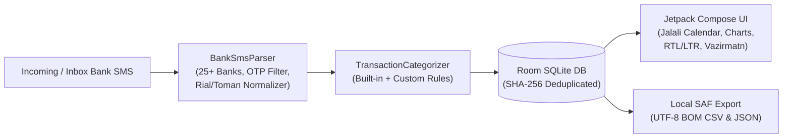

<div align="center">
  
  <h1>خرج‌نگار — KharjNegar</h1>
  <p><strong>100% Offline, Open-Source Iranian Bank SMS Expense Tracker for Android</strong><br/>
  <strong>ردیاب هزینه‌های بانکی از روی پیامک — ۱۰۰٪ آفلاین و متن‌باز برای اندروید</strong></p>

  <p>
    <a href="https://hamidrezaashkiyan.github.io/kharjnegar/"></a>
    <a href="https://github.com/HamidRezaAshkiyan/kharjnegar/releases/latest"></a>
    <a href="https://github.com/HamidRezaAshkiyan/kharjnegar/actions/workflows/ci.yml"></a>
    <a href="LICENSE"></a>
  </p>

  <p>
    <a href="https://hamidrezaashkiyan.github.io/kharjnegar/">🌐 Project Website & Live SMS Parser Demo</a> ·
    <a href="https://github.com/HamidRezaAshkiyan/kharjnegar/releases/latest">⬇️ Download APK (~1.6 MB)</a> ·
    <a href="#privacy-guarantee">🛡️ Privacy Audit</a> ·
    <a href="#supported-iranian-banks-25">🏦 Supported Banks</a>
  </p>
</div>

---

## Why KharjNegar?

Most expense trackers require cloud accounts, bank logins, or internet access — exposing sensitive SMS and financial history. **KharjNegar (خرج‌نگار)** is built from the ground up in native **Kotlin + Jetpack Compose** to parse Iranian bank SMS **100% on-device**, with **zero `INTERNET` permission** enforced automatically in CI.

> **چرا خرج‌نگار؟**  
> خرج‌نگار هیچ مجوز اینترنتی (`INTERNET`) ندارد، حساب کاربری نمی‌خواهد و تمام پیامک‌های بانکی شما را کاملاً آفلاین روی گوشی تحلیل و دسته‌بندی می‌کند.

---

## Privacy Guarantee

- **Zero `INTERNET` Permission**: `android.permission.INTERNET` and `android.permission.ACCESS_NETWORK_STATE` are intentionally **not declared** in [`AndroidManifest.xml`](app/src/main/AndroidManifest.xml).
- **Zero Cloud Backup**: `android:allowBackup="false"` prevents Android from syncing your local SQLite database to external cloud backups.
- **Zero Trackers or Analytics**: No Firebase, no Crashlytics, no ad SDKs, no network libraries.
- **Automated CI Enforcement**: Every push and release runs `aapt2 dump permissions` on the compiled APK and fails the build if any network permission is ever introduced.

Verify any release APK yourself:

```bash
aapt2 dump permissions kharjnegar-v1.0.0.apk
```

Expected output:

```text
package: com.kharjnegar.app
uses-permission: name='android.permission.READ_SMS'
uses-permission: name='android.permission.RECEIVE_SMS'
uses-permission: name='android.permission.POST_NOTIFICATIONS'
```

---

## Architecture (100% On-Device)



---

## Features

| Feature | Description |
| :--- | :--- |
| **Real-Time & Inbox SMS Capture** | Listens for incoming bank SMS via `BroadcastReceiver` and scans existing SMS (30d / 90d / 1y / All) read-only with SHA-256 deduplication. |
| **Smart OTP & Noise Filtering** | Ignores dynamic passwords (`رمز پویا`), verification codes (`کد تایید`), failed transactions (`ناموفق`), and promotional SMS. |
| **Rial & Toman Normalization** | Detects `ریال` vs. `تومان` per SMS and per bank automatically, normalizes internally, and displays in your preferred unit. |
| **Native Jalali (Shamsi) Calendar** | Pure Kotlin Solar Hijri calendar (`فروردین` .. `اسفند`) with monthly switcher, daily spending bar chart, and 6-month income vs. expense chart. |
| **Multi-Bank Balance Tracking** | Automatically extracts and displays the latest reported balance for each bank & account suffix. |
| **Smart Auto-Categorization** | Built-in rules for popular Iranian merchants (Snapp, SnappFood, Digikala, Ofogh Kourosh, Irancell, Hamrah-e Aval, pharmacies, utility bills, transfers, bank fees, salary). |
| **Built-In SMS Parser Tester** | Paste any bank SMS directly inside the app (or try the [online demo](https://hamidrezaashkiyan.github.io/kharjnegar/#demo)) to preview parsed fields before saving. |
| **Bilingual RTL/LTR + Vazirmatn** | Instant toggle between Persian (`فارسی` RTL) and English (LTR) with offline bundled Vazirmatn fonts and Material 3 Light/Dark themes. |
| **Offline Backup & Export** | UTF-8 BOM CSV export (opens cleanly in Excel with Persian intact) and full JSON backup/restore via Android Storage Access Framework. |

---

## Supported Iranian Banks (25+)

| Bank | فارسی | Default SMS Unit | Bank | فارسی | Default SMS Unit |
| :--- | :--- | :--- | :--- | :--- | :--- |
| **Bank Mellat** | بانک ملت | Rial | **Shahr Bank** | بانک شهر | Rial |
| **Bank Melli Iran** | بانک ملی ایران | Rial | **Ayandeh Bank** | بانک آینده | Rial |
| **Blu Bank** | بلوبانک | Toman | **Resalat Bank** | بانک رسالت | Rial |
| **Saman Bank** | بانک سامان | Rial | **Mehr Iran Bank** | بانک مهر ایران | Rial |
| **Bank Saderat** | بانک صادرات | Rial | **Sina Bank** | بانک سینا | Rial |
| **Bank Tejarat** | بانک تجارت | Rial | **Eghtesad Novin** | بانک اقتصاد نوین | Rial |
| **Bank Sepah** | بانک سپه | Rial | **Karafarin Bank** | بانک کارآفرین | Rial |
| **Bank Pasargad** | بانک پاسارگاد | Rial | **Bank Dey** | بانک دی | Rial |
| **Wepod** | ویپاد | Rial / Toman | **Tourism Bank** | بانک گردشگری | Rial |
| **Bank Keshavarzi** | بانک کشاورزی | Rial | **Sarmayeh Bank** | بانک سرمایه | Rial |
| **Refah Bank** | بانک رفاه | Rial | **Iran Zamin Bank** | بانک ایران زمین | Rial |
| **Bank Maskan** | بانک مسکن | Rial | **Post Bank Iran** | پست بانک ایران | Rial |
| **Parsian Bank** | بانک پارسیان | Rial | **Generic Fallback** | سایر بانک‌ها | Auto-detected |

---

## Installation

1. Download the latest APK from [GitHub Releases](https://github.com/HamidRezaAshkiyan/kharjnegar/releases/latest) (Android 8.0 / API 26+, ~1.64 MB).
2. Verify the SHA-256 checksum (optional):
   ```bash
   sha256sum -c kharjnegar-v1.0.0.apk.sha256
   ```
3. Install the APK on your Android device.
4. Open **KharjNegar** and tap **اسکن پیامک (Scan SMS)** — or tap **بارگذاری نمونه آزمایشی (Load Sample Data)** to explore first without granting SMS permissions.

---

## Building from Source

Requirements: **JDK 17**, **Android SDK (API 35)**, **Gradle 8.11.1+**.

```bash
git clone https://github.com/HamidRezaAshkiyan/kharjnegar.git
cd kharjnegar

# Run all 25 unit tests (SMS parser, Jalali calendar, categorizer, backup/export)
gradle testDebugUnitTest

# Build R8-minified Release APK
gradle assembleRelease
```

---

## Contributing

Contributions are welcome! Especially new Iranian bank SMS format samples (with personal account numbers redacted) and unit test cases in [`BankSmsParserTest.kt`](app/src/test/java/com/kharjnegar/app/BankSmsParserTest.kt).

---

## License

MIT License — see [LICENSE](LICENSE).
